<div align="center">


[](https://git.io/typing-svg)

<!-- Matrix-style face scan animation (pure SVG + CSS, no JS) -->


> **4th-Year student passionate about building full-stack web applications, exploring cybersecurity, and leveraging cutting-edge AI developer workflows.**

[](#)


</div>



## `> whoami`

```ts
const sai = {
  role:      "Incoming 4th-Year Software Engineering Student",
  passions:  ["Software Architecture", "Cybersecurity", "Modern AI"],
  building:  "Full-stack software, new frameworks, tricky algorithmic problems",
  workflow:  ["Cursor", "Antigravity IDE", "Claude", "Gemini"],   // ship cleaner code, faster
  teamwork:  "Academic + personal production-grade projects",
  currently: "📸 AI Campus Event Photo Finder — Senior Project",
  motto:     "Always learning. Always shipping reliable software.",
};
```


## `> ls ./stack`

<div align="center">

| | |
|:--|:--|
| **Languages & Core** | [](#) |
| **Frameworks, Cloud & Deployment** | [](#) |
| **Data & Observability** |  |

**AI Tools & Advanced Environments**


</div>


## `> ls ./projects`

[...;%3E+Loading+High-Dimensional+Vector+Search...;%3E+Executing+Biometric+Recognition+Pipelines...)](https://git.io/typing-svg)

<table>
<tr>
<td width="50%" valign="top">

### 📸 AI Campus Event Photo Finder
<sub>`SENIOR PROJECT` · `2025 – PRESENT`</sub>

AI-powered campus photo discovery using facial recognition and high-dimensional vector search — automated photo matching, real-time uploads, role-based workflows, and a privacy-first design with face blurring and PDPA-compliant consent flows.


[](https://github.com/kwanphotofinder/photofinder)
[](https://photofinder-five.vercel.app)


</td>
<td width="50%" valign="top">

### 🛡️ Mini Log Management System
<sub>`SIEM-LITE` · `2026`</sub>

Multi-tenant log management / SIEM-lite that ingests firewall, syslog, app, AWS CloudTrail, Microsoft 365, Active Directory and CrowdStrike logs, normalizes them into one schema, and offers search, dashboards and brute-force / port-scan / malware alerts with strict tenant isolation.


[](https://github.com/SAISENGMAIN6631503085/log-mgmt)
[](https://14.207.143.101.sslip.io)

</td>
</tr>
<tr>
<td width="50%" valign="top">

### 🎓 AdvisingLog
<sub>`2025 – PRESENT`</sub>

University advising & student support platform streamlining advisory workflows, early academic intervention, and student exit management — role-based access, bilingual support, automated AUN-QA compliance reporting, and interactive data visualization.


[](https://github.com/advisinglog/advising-log)
[](https://se-advising-log.vercel.app)


</td>
<td width="50%" valign="top">

### 🍳 Chef's Companion
<sub>`2025 – PRESENT`</sub>

High-performance restaurant POS with ESC/POS thermal printing, live order lifecycle tracking, and an edge-native backend.


</td>
</tr>
</table>


## `> git log --activity`

<div align="center">


<picture>
  <source media="(prefers-color-scheme: dark)" srcset="https://raw.githubusercontent.com/SAISENGMAIN6631503085/SAISENGMAIN6631503085/output/snake-matrix.svg" />
  <source media="(prefers-color-scheme: light)" srcset="https://raw.githubusercontent.com/SAISENGMAIN6631503085/SAISENGMAIN6631503085/output/snake-light.svg" />
  
</picture>

</div>


## `> ping sai`

<div align="center">

[](https://git.io/typing-svg)

[](#)
[](mailto:your.email@example.com)
[](#)

<sub>`[ connection closed ]` — thanks for stopping by ✦</sub>

</div>
